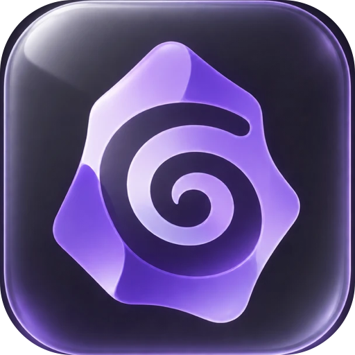

<div align="center">



# Muesli pour Obsidian

**Granola, dans Obsidian. Le bloc-notes IA pour les réunions qui s'enchaînent.**

Notes, actions et mémoire, directement dans ton coffre. **Sans bot de réunion.**

[](LICENSE)


[](https://community.obsidian.md/plugins/muesli)

[English](README.md) · **Français**

[Installation](#installation) · [Configuration](#configuration) · [Fonctionnement](#fonctionnement) · [Confidentialité](#confidentialité-et-transparence)

</div>

---

## Pourquoi Muesli ?

Tu enchaînes les appels. Tu veux écouter, noter trois mots, et ressortir avec des notes propres et une liste de tâches. Pas un bot dans la liste des participants, pas une app de plus, pas tes notes enfermées dans le cloud de quelqu'un d'autre.

- **Aucun bot ne rejoint ton appel.** Muesli enregistre ton micro et le son de ton Mac : ça marche avec Zoom, Meet, Teams, Slack, un appel dans le navigateur — tout ce qui fait du son.
- **Tes notes d'abord.** Tape quelques mots pendant que les gens parlent. Le compte rendu se construit *autour* d'elles, complété par ce qui a vraiment été dit.
- **Des actions à suivre.** Les tâches sortent au format `- [ ] Paul — envoyer le récap (vendredi)`, prêtes pour Tasks, Dataview et Bases.
- **Une mémoire qui reste à toi.** Chaque réunion est un dossier de Markdown dans ton coffre : cherchable, reliable à tes personnes et projets, synchronisé comme tu synchronises déjà.
- **Ta propre clé.** Une clé [OpenRouter](https://openrouter.ai), paiement à l'usage (environ **0,10 $ par heure** de parole). Pas d'abonnement, pas de compte chez nous.

## Ce que tu obtiens

Clique sur l'icône 🎙️, choisis **Réunion**, et écris dans le `Notes.md` qui s'ouvre. Clique sur stop. Quelques secondes plus tard :

```
Réunions/2026-10-09 1430 Revue tarifs Acme/
  Résumé.md       ← TL;DR, décisions, actions, points abordés, questions ouvertes
  Transcript.md   ← « qui a dit quoi » mis au propre, horodaté
  Notes.md        ← tes notes brutes, intactes
  audio.mp3       ← enregistrement (optionnel)
```

Le titre est choisi par l'IA d'après le contenu. Les intervenants sont nommés grâce à la conversation (« merci Paul… »), et tu confirmes ou corriges dans une seule fenêtre.

## Deux usages

| | **Réunion** | **Journal** |
|---|---|---|
| Pour | Les appels sur ton Mac (micro + son système), le présentiel, n'importe quel enregistrement | Penser à voix haute : tâches, projets, idées, humeur |
| Résultat | Un dossier de réunion avec résumé, transcript, notes et audio | Une entrée de bullet journal ajoutée à la note du jour ; audio et transcript dans `Notes vocales/` |

### Pendant la réunion

- **Des notes horodatées.** Chaque ligne tapée est horodatée en silence, et *Marquer ce moment* pose un repère `⏱ 12:34`. Le résumé s'en sert pour aligner tes notes sur la conversation.
- **Impossible d'oublier d'arrêter.** Une petite pilule toujours au premier plan affiche l'enregistrement, le temps écoulé et le coût estimé au-dessus de toutes les apps, et reste **invisible dans les partages d'écran et les captures**. Après un long silence, Muesli demande si la réunion continue, et l'arrête toute seule sans réponse.
- **Prêt dès l'arrêt.** L'audio est transcrit en arrière-plan *pendant* la réunion : le résultat arrive quelques secondes après le stop.

### Enregistré ailleurs ? Importe-le

Un mémo vocal du téléphone, un `.m4a` de dictaphone, un `.mp3` qu'on t'a envoyé : dépose-le dans `Réunions/À importer` (AirDrop, iCloud Drive, Finder), fais un clic droit sur un fichier audio du coffre → **Créer une réunion depuis cet audio**, ou lance *Importer un enregistrement audio* pour choisir un fichier n'importe où sur le disque. Tu obtiens le même dossier, avec l'audio d'origine.

### Les mémos Dictaphone de l'iPhone, traités sur le Mac

Active *Traiter les nouveaux mémos automatiquement* (macOS) : chaque nouveau mémo Dictaphone synchronisé par iCloud est transcrit, reconnu comme réunion ou journal d'après ce qui est dit, et rangé — tant qu'Obsidian est ouvert. Enregistre écran verrouillé, retrouve-le dans ton coffre. Nécessite l'accès complet au disque pour Obsidian.

### Sur le téléphone

Touche l'icône micro pour ouvrir l'**enregistreur** : choisis **Journal** ou **Réunion** (présentiel, micro seul), puis un seul gros bouton. iOS coupe le micro des apps en arrière-plan : garde Obsidian au premier plan pendant l'enregistrement (l'écran reste allumé). La clé OpenRouter est stockée par appareil : saisis-la aussi sur le téléphone.

## Installation

**Depuis Obsidian (recommandé)** : *Réglages → Plugins communautaires → Parcourir*, cherche **Muesli**, puis *Installer* et *Activer*. Ou ouvre [Muesli dans le répertoire de la communauté](https://community.obsidian.md/plugins/muesli) et choisis *Add to Obsidian*.

**Avec BRAT** (dernières versions) : installe [BRAT](https://github.com/TfTHacker/obsidian42-brat), puis *BRAT: Add a beta plugin* → `Azilone/obsidian-muesli`.

**À la main** : télécharge `main.js`, `manifest.json` et `styles.css` depuis la [dernière release](https://github.com/Azilone/obsidian-muesli/releases/latest) dans `<ton coffre>/.obsidian/plugins/muesli/`, puis active **Muesli**.

**Depuis les sources** : voir [CONTRIBUTING.md](CONTRIBUTING.md#development).

### Prérequis

| | Visio (micro + son système) | Présentiel, journal, import |
|---|---|---|
| macOS 14.4+ | ✅ | ✅ |
| Windows, Linux | — (micro seul pour l'instant) | ✅ |
| iOS, Android | — | ✅ (écran enregistreur) |

Obsidian 1.11.4 ou plus récent, et une [clé API OpenRouter](https://openrouter.ai/keys) avec quelques dollars de crédit.

## Configuration

Au premier lancement, un **écran de configuration** te guide (accessible aussi depuis *Réglages → Muesli → Configuration* ou la commande *Configurer Muesli*) :

1. **Clé API OpenRouter** : crée-la sur [openrouter.ai/keys](https://openrouter.ai/keys) et colle ta clé. Elle est vérifiée tout de suite, le crédit restant s'affiche, et elle est stockée dans le trousseau d'Obsidian (jamais dans ton coffre ni dans `data.json`).
2. **Ton nom** : utilisé pour ton micro dans les transcripts.
3. **Test du son (Mac)** : Muesli installe son petit helper audio (voir [transparence](#confidentialité-et-transparence)), puis macOS demande d'autoriser **Muesli** à enregistrer le son de l'ordinateur. Accepte, sinon les autres participants ne seront pas captés. Lance un son pendant le test : les deux jauges doivent bouger. Autorisation modifiable ensuite dans *Réglages Système → Confidentialité et sécurité → Enregistrement de l'écran et de l'audio système*. macOS peut redemander après une mise à jour.
4. Optionnel : **type de réunion par défaut** (visio ou présentiel), **modèle de résumé par défaut**, **langue du résumé**, et les dossiers.

C'est tout : icône → **Réunion** → écris → stop.

## Modèles de résumé

Les modèles sont de simples notes dans `Réunions/Modèles`. Leur contenu décrit le résumé voulu, avec tes mots. Deux sont créés pour toi, **Général** et **1:1**. Duplique-en un, réécris les sections (appel commercial, point d'équipe, entretien…) et choisis-le par défaut dans les réglages.

## Langue

L'interface, les dossiers par défaut, les modèles et les prompts de l'IA suivent la langue d'Obsidian : **français** si Obsidian est en français, **anglais** sinon. La transcription détecte la langue parlée (ou tu la fixes), et le résumé est rédigé dans la *langue du résumé* choisie, quelle que soit la langue de la réunion.

## Fonctionnement

| Brique | Rôle |
|---|---|
| **Micro** | Capté avec Web Audio. En visio, c'est *toi* : tu es toujours bien attribué. |
| **Son système** | Un petit helper natif (`meeting-tap`, Swift, ~270 Ko) capte la sortie audio du Mac via les *process taps* de Core Audio. C'est ainsi que les autres participants sont entendus, sans bot ni pilote audio virtuel. |
| **Suppression des silences** | Un détecteur de voix local retire les silences avant tout envoi (la transcription est facturée à la seconde). Les segments sont coupés *dans* les silences, aucun mot n'est tronqué, et les horodatages sont recalés sur l'horloge réelle. Un segment sans parole n'est jamais envoyé. |
| **Transcription** | [`microsoft/mai-transcribe-2`](https://openrouter.ai/microsoft/mai-transcribe-2) via OpenRouter, avec diarisation des voix. |
| **Mise au propre et résumé** | Un petit LLM (`anthropic/claude-haiku-5.5` par défaut, tout modèle OpenRouter fonctionne) relie les voix d'un segment à l'autre, corrige les erreurs de reconnaissance, retire les tics de langage, rédige le résumé et choisit un titre. Tes notes sont l'entrée la plus importante. |

Tout est d'abord écrit dans ton coffre (`<réunion>/.raw/`) : un plantage ou un appel API raté ne fait jamais perdre une réunion. **Retraiter la réunion** (commande, ou clic droit sur le dossier) reprend là où ça s'est arrêté.

### Coût

Tu paies OpenRouter directement. En ordre de grandeur : environ **0,10 $ par heure de parole** après suppression des silences, plus quelques centimes de LLM par réunion. L'estimation s'affiche en direct dans l'overlay, le coût réel à la fin du traitement.

## Réglages

| Réglage | Par défaut |
|---|---|
| Type de réunion par défaut | Visio (micro + son système) / Présentiel (micro seul, toutes les voix séparées) |
| Modèle de résumé par défaut | `Général` |
| Langue | Détection automatique |
| Langue du résumé | français (anglais si Obsidian est en anglais) |
| Garder l'audio | Oui |
| Durée des segments | 8 min |
| Overlay flottant | Oui, invisible dans les partages d'écran |
| Demander après N min sans parole / arrêt après | 10 min / 5 min |
| Durée maximale | 180 min |
| Modèles | `microsoft/mai-transcribe-2`, `anthropic/claude-haiku-5.5` |
| Dossiers | `Réunions`, `Réunions/Modèles`, `Réunions/À importer`, `Notes vocales` |
| Note du jour | Réglages du plugin *Notes quotidiennes*, ou ton propre chemin Moment |

## Confidentialité et transparence

- **Réseau** : l'audio et le texte partent **uniquement vers [OpenRouter](https://openrouter.ai)** (et les fournisseurs de modèles vers lesquels il route), avec ta clé. Aucune télémétrie, aucune analytics, aucun serveur à nous.
- **Service payant** : OpenRouter est facturé à l'usage ; il faut un compte et du crédit.
- **Helper natif (macOS)** : la capture du son système et le décodage rapide passent par `meeting-tap`, un petit programme Swift open source ([`native/macos/main.swift`](native/macos/main.swift)). Obsidian n'installe que `main.js`, `manifest.json` et `styles.css` : le build de release intègre donc le helper compilé dans `main.js` (avec son SHA-256), et Muesli l'écrit dans son dossier de plugin au premier usage. Rien n'est téléchargé. Les fichiers de release sont construits par GitHub Actions depuis ce dépôt, avec [attestations de provenance](https://github.com/Azilone/obsidian-muesli/attestations) : `main.js` peut ainsi être relié à ce code source. Tu peux aussi le compiler toi-même avec `./native/build.sh`.
- **Fichiers hors du coffre** : seulement quand tu importes un fichier du disque, ou avec la boîte de réception Dictaphone optionnelle (lit `~/Library/Group Containers/group.com.apple.VoiceMemos.shared`, accès complet au disque requis).
- Les segments audio bruts et les réponses API restent dans un dossier caché `.raw/` de chaque réunion. Supprime-le quand le résultat te convient. Tu synchronises ton coffre avec git ? Pense à ajouter `**/.raw/` et `*.mp3` au `.gitignore`.
- **Préviens toujours les participants que tu enregistres**, et respecte les lois sur le consentement là où tu vis.

## Développement

```bash
bun install
bun run check                        # type-check + tests (VAD, découpage, fusion, journal)
./native/build.sh                    # helper universel (arm64 + x86_64), signé ad hoc
VAULT="/chemin/du/coffre" bun run dev   # mode watch, build directement dans le coffre
```

Le helper écrit du PCM brut (s16le, mono, 16 kHz) sur stdout et des lignes JSON d'état sur stderr, et s'arrête quand son stdin se ferme. `meeting-tap --decode fichier.m4a` décode n'importe quel fichier audio au même format (utilisé pour les imports). Tout helper qui respecte ce contrat peut être ajouté pour Windows (WASAPI loopback) ou Linux (PipeWire monitor) — contributions bienvenues.

Toute chaîne visible passe par `src/i18n.ts` (anglais **et** français), les prompts par `src/pipeline/prompts.ts`. Voir [CONTRIBUTING.md](CONTRIBUTING.md).

## Feuille de route

- Helpers son système pour Windows et Linux
- Transcript en direct pendant l'enregistrement
- « Demande à tes réunions » : un chat sur tout le coffre
- Titre et participants depuis le calendrier

## Licence

[MIT](LICENSE)
